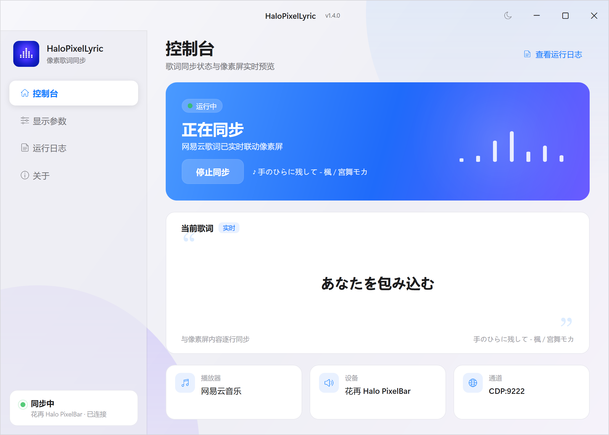

# HaloPixelLyric — 网易云歌词 → 花再 Halo PixelBar 像素屏

轻量级单文件工具：把网易云音乐正在播放的歌词实时推送到 **花再 Halo PixelBar** 像素屏。

它通过 **CDP（Chrome DevTools Protocol）** 读取网易云 CEF 页面里的**原生播放进度事件**
（`audioplayer.onPlayProgress`，30Hz），再用歌曲时间轴对歌词定位与分页。
不注入 DLL、不读写进程内存、不依赖网易云版本偏移；网易云窗口最小化、切到托盘、
不开桌面歌词，都不影响歌词同步。



> 本项目是完全 vibe coding 的产物：由 [ZCode](https://zcode.dev)（模型 **GLM-5.3**）与本人
> 通过自然语言协作完成——从方案调研、可行性实测、全部代码到发布打包，均由 AI 编写，
> 本人仅仅负责提出需求、实测体验与方向决策。功劳归于 AI 协作，不归于个人。

## 特性

- **与网易云 UI 彻底解耦**：订阅原生进度事件流，而不是读 DOM 的“当前歌词”标记；
  托盘运行、最小化、关闭桌面歌词都能持续工作
- **进度驱动显示**：当前行与翻页由歌曲时间轴决定，暂停/拖动进度条/切歌天然正确
- **暂停自动回时钟**：进度流静默 3 秒后，像素屏自动恢复时钟模式；继续播放自动恢复歌词
- **长句智能分页**：超过屏幕宽度（全角 16 字 / 半角 32 字符）自动分页，优先在空格/标点处断开，
  两页均衡，不出现孤字尾页
- **间奏异常钳制**：识别网易云“间奏前一句 + 整段间奏”被计为单句时长的时间戳问题
- **无歌词歌曲处理**：纯音乐/无词歌曲显示一次歌名后安静，不反复刷屏
- **断线自愈**：网易云 CEF 的 watchdog 约每 31 秒断开一次 CDP 连接，自动重连并重新注入（约 0.2 秒）
- **苹果风格界面**：浅色/深色主题、启动动画、页面切换动画、状态呼吸灯、歌词淡入淡出、
  内嵌确认框与 Toast；参数滑块、运行日志、系统托盘
- 文件日志：exe 同目录 `halolyric.log`（超 2MB 自动轮转），排障无需盯界面
- 退出时自动把像素屏恢复为时钟模式

## 系统要求

- Windows 10/11 x64（单文件自带运行时，无需安装 .NET）
- 漫步者花再 Halo PixelBar（USB 连接电脑）
- 网易云音乐 PC 版（任意较新版本；开发验证于 3.1.36）

## 快速开始

1. 解压任意目录，双击 `HaloPixelLyric.exe`
2. 点击控制台页的 **启动同步**；如果网易云没有开启调试端口，会询问是否带
   `--remote-debugging-port=9222` 重启网易云，确认后自动完成
3. 正常播放即可。**不需要打开播放页，也不需要开启桌面歌词**；网易云在后台、最小化或托盘都能工作
4. 关闭窗口 = 最小化到系统托盘继续工作；托盘右键 **退出** 才真正退出
   （会自动把像素屏恢复为时钟模式）

界面上可实时调整显示参数（翻页提前量、预推提前量、屏幕容量、间奏钳制倍数），
保存后立即生效并持久化到 `settings.json`。

## 显示参数

| 参数 | 默认 | 作用 |
|---|---|---|
| 翻页提前量 | 280 ms | 句内换页提前触发，抵消轮询 + HID + 固件动画的链路延迟 |
| 预推提前量 | 350 ms | 每句第一屏的独立提前量；编排时间与实际演唱存在系统偏差，通常比翻页略大 |
| 屏幕容量 | 16.0 全角单位 | 像素屏一行可容纳的字数（半角算 0.5） |
| 间奏钳制倍数 | 3.0× | 官方句长超过按字数估算时长的 N 倍时，按间奏处理 |

调参建议：如果换页**抢拍**（歌词比演唱早），调小提前量；**慢半拍**，调大提前量。

## 工作原理

```
网易云音乐（CEF/Chromium，启动参数 --remote-debugging-port=9222）
  → CDP 注入 watcher：注册 audioplayer.onPlayProgress（原生 30Hz 进度流）
  → 60ms 轮询读取 playId / 进度 / 歌词 / 歌名
  → 新播放会话需连续 3 次进度递增才采纳（过滤托盘时的预加载会话）
  → 进度映射到歌词时间轴 → 分页 / 预推 / 间奏钳制 / 暂停回时钟
  → USB HID 推送到像素屏（静态居中布局）
```

歌词优先取逐字 `yrc`；部分歌曲 `lv=1` 返回空歌词，watcher 会自动回退到 `lv=-1` 重取。
歌名优先来自 `player.setInfo` 钩子，若新版网易云未触发，则用 `song/detail` API 兜底。

## 命令行参数

| 参数 | 作用 |
|---|---|
| （无） | 启动图形界面 |
| `--clock` | 仅把像素屏恢复为时钟模式后退出 |
| `--calibrate` | 屏宽标定：汉字 4~14（默认）/ `--calibrate en` 半角 20~40 |

## 已知问题

- **像素屏字库缺字**：个别生僻日文汉字/符号无法渲染（设备字库覆盖问题，缺字处显示空白）
- 歌词行超过 55 UTF-8 字节时尾部截断（HID 单包 64 字节上限；分页后单页天然不触发）
- 请勿与官方客户端 / 其他工具的歌词推送同时开启（多程序写同一 HID 设备会互相覆盖）
- CDP 调试端口 9222 仅监听本机；不想要调试口时正常重启网易云即可
- 个别网易云前端大改版可能需要调整 `WatcherScript.cs` 中的接口名

## 构建

需要 [.NET 10 SDK](https://dotnet.microsoft.com/)。

```bash
# 调试构建
dotnet build -c Debug

# 发布单文件（自包含，免安装运行时）
dotnet publish -c Release -r win-x64 --self-contained true \
  -p:PublishSingleFile=true -p:IncludeNativeLibrariesForSelfExtract=true \
  -p:EnableCompressionInSingleFile=true
```

## 致谢与开源许可

本项目采用 MIT 许可（见 [LICENSE](./LICENSE)）。

- USB HID 通信层源自 [XFEstudio/HaloPixelToolBox](https://github.com/XFEstudio/HaloPixelToolBox)（MIT）
- 设备协议文档参考 [Seraph310/halo-pixelbar-mcp](https://github.com/Seraph310/halo-pixelbar-mcp)（MIT）
- 界面图标由 GPT-Image 生成后做透明化与切图处理

本项目仅用于个人学习与研究，与漫步者/网易官方无关。
