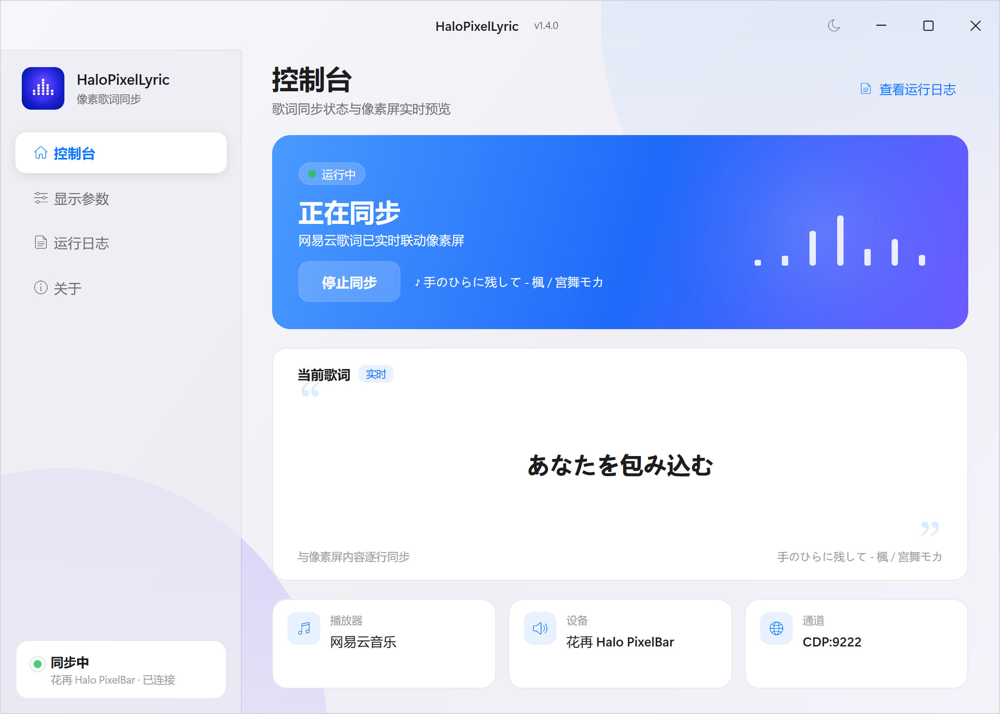

# HaloPixelLyric — 网易云歌词 → 花再 Halo PixelBar 像素屏

轻量级单文件工具：把网易云音乐正在播放的歌词实时推送到 **花再 Halo PixelBar** 像素屏。

默认模式通过 **CDP（Chrome DevTools Protocol）** 读取网易云 CEF 页面里的**原生播放进度事件**
（`audioplayer.onPlayProgress`，30Hz），再用歌曲时间轴对歌词定位与分页。
不注入 DLL、不读写进程内存、不依赖网易云版本偏移；网易云窗口最小化、切到托盘、
不开桌面歌词，都不影响歌词同步。

新增可选 **Windows SMTC（System Media Transport Controls）** 来源：读取系统媒体会话的
歌名、歌手、专辑和播放时间轴，再匹配网易云曲库获取歌词，无需开启调试端口或重启播放器。
SMTC 不提供歌词正文和网易云歌曲 ID，因此匹配可能失败或匹配到不同录音版本。

| 来源 | 播放信息及歌词 | 使用条件 |
|---|---|---|
| 网易云 CDP（默认） | 原生进度事件、准确歌曲 ID，按 ID 获取歌词 | 网易云调试端口，首次可能需要确认重启 |
| Windows SMTC（可选） | 系统播放状态和时间轴，按元数据匹配网易云歌词 | 播放器提供系统媒体控制及有效时间轴，无需调试端口 |



截图来自旧版界面；当前控制台新增了“同步来源”分段选择控件。

> 本项目是完全 vibe coding 的产物：由 [ZCode](https://zcode.dev)（模型 **GLM-5.3**）与本人
> 通过自然语言协作完成——从方案调研、可行性实测、全部代码到发布打包，均由 AI 编写，
> 本人仅仅负责提出需求、实测体验与方向决策。功劳归于 AI 协作，不归于个人。

## 特性

- **双模式可选**：控制台选择 CDP / SMTC 后自动保存；默认 CDP，兼容旧配置。运行及停止收尾期间禁止切换，避免同时写入设备
- **SMTC 同步**：播放时按时间轴平滑推算进度，暂停冻结；异步匹配歌词，切歌取消旧请求，网络错误最多尝试 3 次

- **与网易云 UI 彻底解耦**：订阅原生进度事件流，而不是读 DOM 的“当前歌词”标记；
  托盘运行、最小化、关闭桌面歌词都能持续工作
- **进度驱动显示**：当前行与翻页由歌曲时间轴决定，暂停/拖动进度条/切歌天然正确
- **暂停自动回时钟**：进度流静默 3 秒后，像素屏自动恢复时钟模式；继续播放自动恢复歌词
- **长句智能分页**：超过屏幕宽度（全角 16 字 / 半角 32 字符）自动分页，优先在空格/标点处断开，
  两页均衡，不出现孤字尾页
- **间奏异常钳制（SMTC）**：识别网易云“间奏前一句 + 整段间奏”被计为单句时长的时间戳问题
- **无歌词歌曲处理**：纯音乐/无词歌曲显示一次歌名后安静，不反复刷屏
- **断线自愈（CDP）**：网易云 CEF 的 watchdog 约每 31 秒断开一次 CDP 连接，自动重连并重新注入（约 0.2 秒）
- **苹果风格界面**：浅色/深色主题、启动动画、页面切换动画、状态呼吸灯、歌词淡入淡出、
  内嵌确认框与 Toast；参数滑块、运行日志、系统托盘
- 文件日志：exe 同目录 `halolyric.log`（超 2MB 自动轮转），排障无需盯界面
- 退出时自动把像素屏恢复为时钟模式

## 系统要求

- Windows 10 1809（17763）或更新版本 / Windows 11，x64（单文件自带运行时，无需安装 .NET）
- 漫步者花再 Halo PixelBar（USB 连接电脑）
- CDP 模式：网易云音乐 PC 版（任意较新版本；原版开发验证于 3.1.36）
- SMTC 模式：播放器需发布歌名、歌手、播放状态及有效时间轴，并可访问网易云曲库接口

## 快速开始

1. 解压任意目录，双击 `HaloPixelLyric.exe`，通过 USB 连接像素屏。
2. 在控制台的 **同步来源** 选择 **网易云 CDP**（默认）或 **Windows SMTC**，选择后自动保存。
3. CDP 模式点击 **启动同步**；如果网易云没有开启调试端口，会询问是否带
   `--remote-debugging-port=9222` 重启网易云，确认后自动完成，取消则停止服务。
4. SMTC 模式先开启播放器的“系统媒体控制 / SMTC”并播放音乐，再点击 **启动同步**。
   不需要调试端口或重启播放器；首次曲库匹配需要网络时间。未提供有效时间轴或没有可靠匹配时，仅显示歌名后恢复时钟。
5. 正常播放即可。无需打开播放页或开启桌面歌词；可后台、最小化或托盘运行。
6. 切换来源时先停止同步，待完成时钟恢复后，选择另一来源再启动。
7. 关闭窗口 = 最小化到系统托盘继续工作；托盘右键 **退出** 才真正退出
   （会自动把像素屏恢复为时钟模式）。

旧版 `settings.json` 的 `CdpPort` 保持有效；缺少 `PlaybackSource` 字段时默认 CDP。
新增 `PlaybackSource` 字段：`0` 为 CDP，`1` 为 SMTC。

界面上可实时调整显示参数（翻页提前量、预推提前量、屏幕容量、间奏钳制倍数），
保存后立即生效并持久化到 `settings.json`。翻页提前量与屏幕容量适用于两种模式；
预推提前量和间奏钳制当前仅用于 SMTC，CDP 保留原版调度方式。

## 显示参数

| 参数 | 默认 | 作用 |
|---|---|---|
| 翻页提前量 | 280 ms | 句内换页提前触发，抵消轮询 + HID + 固件动画的链路延迟 |
| 预推提前量（SMTC） | 350 ms | 每句第一屏的独立提前量；编排时间与实际演唱存在系统偏差，通常比翻页略大 |
| 屏幕容量 | 16.0 全角单位 | 像素屏一行可容纳的字数（半角算 0.5） |
| 间奏钳制倍数（SMTC） | 3.0× | 官方句长超过按字数估算时长的 N 倍时，按间奏处理 |

调参建议：如果换页**抢拍**（歌词比演唱早），调小提前量；**慢半拍**，调大提前量。

## 工作原理

CDP 模式保留原版采集链路：

```
网易云音乐（CEF/Chromium，启动参数 --remote-debugging-port=9222）
  → CDP 注入 watcher：注册 audioplayer.onPlayProgress（原生 30Hz 进度流）
  → 60ms 轮询读取 playId / 进度 / 歌词 / 歌名
  → 新播放会话需连续 3 次进度递增才采纳（过滤托盘时的预加载会话）
  → 进度映射到歌词时间轴 → 分页 / 暂停回时钟
  → USB HID 推送到像素屏（静态居中布局）
```

歌词优先取逐字 `yrc`；部分歌曲 `lv=1` 返回空歌词，watcher 会自动回退到 `lv=-1` 重取。
歌名优先来自 `player.setInfo` 钩子，若新版网易云未触发，则用 `song/detail` API 兜底。

SMTC 模式：

```text
Windows 全局媒体会话（跟随当前会话，未播放时优先其他正在播放的会话）
  → 读取来源 / 歌名 / 歌手 / 专辑 / 播放状态 / 时间轴
  → Position + LastUpdatedTime + PlaybackRate 推算进度
  → 网易云搜索，结合歌名、歌手、专辑和时长保守匹配版本
  → 获取 YRC，缺失时回退 LRC（lv=1 / lv=-1）
  → 每轮等待 60ms，按歌曲进度定位歌词 / 预推 / 分页 / 间奏钳制
  → USB HID 推送到像素屏；暂停或无词时恢复时钟
```

SMTC 没有歌曲 ID 或歌词。版本不明确时仅显示一次歌名，不发送可能匹配错误的歌词。
播放器的系统媒体卡片可见不代表一定提供有效时间轴，同步精度取决于播放器发布的信息。

主要代码：`LyricService.cs` 负责模式选择和事件转发，`CdpLyricService.cs` 保留原版 CDP 服务；
`SmtcMediaSource.cs` 读取系统会话，`NeteaseLyricProvider.cs` 匹配取词，
`SmtcLyricService.cs` 与 `LyricDisplayScheduler.cs` 负责 SMTC 同步和显示调度。


## 命令行参数

| 参数 | 作用 |
|---|---|
| （无） | 启动图形界面 |
| `--clock` | 仅把像素屏恢复为时钟模式后退出 |
| `--calibrate` | 屏宽标定：汉字 4~14（默认）/ `--calibrate en` 半角 20~40 |

## 已知问题

- **SMTC 曲库匹配限制**：现场版、翻唱、重制版或剪辑版本可能不同步；匹配失败时仅显示歌名。取词依赖网易云网络接口，当前不使用播放器登录态
- **SMTC 时间轴限制**：播放器未提供或未及时更新暂停 / seek 时间轴时，无法保证同步准确
- **SMTC 会话选择**：浏览器视频也可能成为当前会话，目前未提供按应用筛选选项

- **像素屏字库缺字**：个别生僻日文汉字/符号无法渲染（设备字库覆盖问题，缺字处显示空白）
- 歌词行超过 55 UTF-8 字节时尾部截断（HID 单包 64 字节上限；分页后单页天然不触发）
- 请勿与官方客户端 / 其他工具的歌词推送同时开启（多程序写同一 HID 设备会互相覆盖）
- CDP 调试端口 9222 仅监听本机；不想要调试口时正常重启网易云即可
- 个别网易云前端大改版可能需要调整 `WatcherScript.cs` 中的接口名

## 构建

需要 [.NET 10 SDK](https://dotnet.microsoft.com/)。SMTC 所需的 Windows SDK .NET 引用通过 NuGet 自动还原。

```bash
# 调试构建
dotnet build -c Debug

# 发布单文件（自包含，免安装运行时）
dotnet publish -c Release -r win-x64 --self-contained true \
  -p:PublishSingleFile=true -p:IncludeNativeLibrariesForSelfExtract=true \
  -p:EnableCompressionInSingleFile=true
```

## 验证

```bash
# 离线检查：播放时间推算、歌词调度、版本匹配、旧配置兼容、模式启停互斥
dotnet run --project tests/HaloPixelLyric.Tests.csproj

# 可选：只读检查本机 SMTC 会话，不操作播放器或音响
dotnet run --project tests/HaloPixelLyric.Tests.csproj -- --smtc

# 可选：真实网络验证网易云搜索及取词
dotnet run --project tests/HaloPixelLyric.Tests.csproj -- --network
```

## 致谢与开源许可

本项目采用 MIT 许可（见 [LICENSE](./LICENSE)）。

- USB HID 通信层源自 [XFEstudio/HaloPixelToolBox](https://github.com/XFEstudio/HaloPixelToolBox)（MIT）
- 设备协议文档参考 [Seraph310/halo-pixelbar-mcp](https://github.com/Seraph310/halo-pixelbar-mcp)（MIT）
- 界面图标由 GPT-Image 生成后做透明化与切图处理

本项目仅用于个人学习与研究，与漫步者/网易官方无关。
